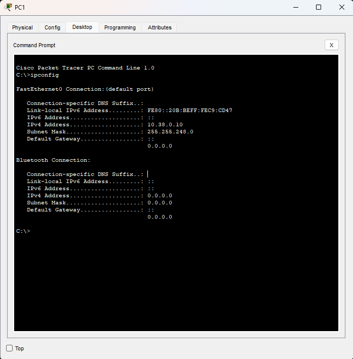
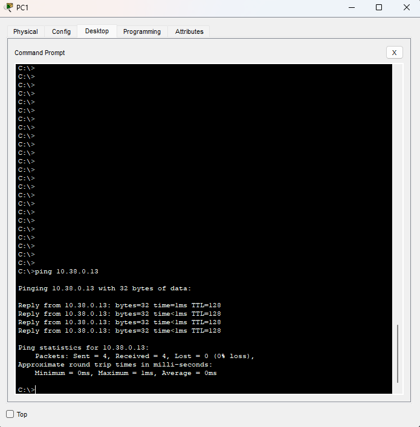
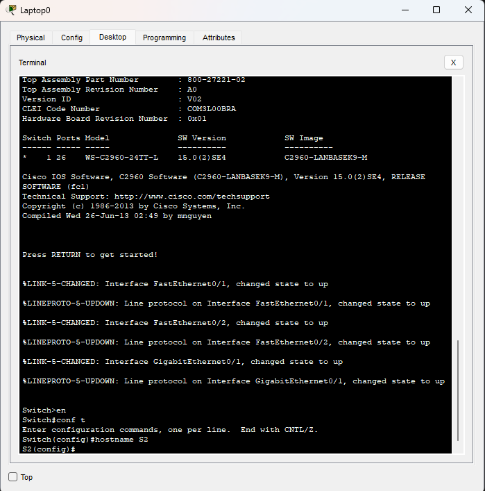

# Popis

LAN Obsahuje 4PC, 2 Switche a 1 Laptop.
PC1 a PC2 jsou napojena na S1 na portech Fa0/1 a Fa0/2.
PC3 a PC4 jsou napojena na S2 na portech Fa0/1 a Fa0/2.
S1 a S2 jsou spojena GigabitEthernetem z portu Gi0/1 na S1 do Gi0/1 na S2.
Rozsah IP adres je 10.X.0.0/16 + Y -> 10.38.0.0/21

# Výpočty X a Y

X: součet ASCII hodnot příjmení % 256:

ZEZULKA do ASCII: 90 + 69 + 90 + 85 + 76 + 75 + 65 = 550
550 % 256 = ==**38**==

Y: součet ASCII hodnot jména % 10:

VACLAV do ASCII: 86 + 65 + 67 + 76 + 65 + 86 =  445
445 % 10 = 5

# Snímky obrazovky

